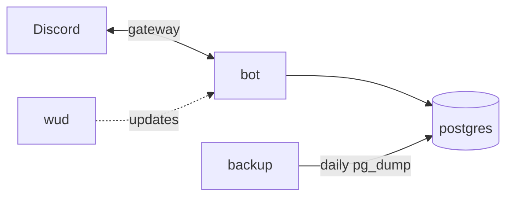

# Architecture

## Services

| Service | Image | `mem_limit` | Role |
|---|---|---|---|
| `postgres` | `postgres:18-alpine` | 1 GB | database, on an internal network with no internet access |
| `bot` | `ghcr.io/<owner>/archive-9-bot` | 384 MB | Discord process |
| `backup` | `postgres:18-alpine` | 64 MB | `pg_dump` at startup then every 24 h, keeps `BACKUP_KEEP_DAYS` days |
| `wud` | `getwud/wud:9` | 128 MB | updates `bot` when a new image is published |

Postgres settings: `shared_buffers=256MB`, `effective_cache_size=640MB`, `work_mem=4MB`, `maintenance_work_mem=64MB`, `max_connections=30`.

## Packages

Dependencies flow one way: `apps → packages`. `core` depends on no other package. `db` is the only one that runs SQL.

Each package exports its `.ts` sources directly. Node runs them through type stripping, which requires erasable TypeScript syntax (`erasableSyntaxOnly`): no `enum`, no `namespace`.

## Bot startup

1. Environment variables are read and validated with zod. The process exits if one is missing.
2. Pending Drizzle migrations are applied.
3. The bot logs in to Discord.
4. A health server listens on `HEALTH_PORT`: `GET /health` returns 200 when Discord is connected and the database responds, 503 otherwise. Docker uses it as the healthcheck.

## Data

Discord IDs are stored as `text`. Dates are `timestamptz`.

| Table | Content |
|---|---|
| `members` | members and bots seen on the server, nickname history, opt-out |
| `messages` | raw messages from listened channels, with reactions and analysis status |
| `profile_facts` | one learned fact per row: category, nature, confidence, sources, reporter; a correction replaces a row through `superseded_by` |
| `profile_summaries` | short summary of each profile |
| `relationships` | ARCHIVE-9's affinity (−100 to 100), trust (0 to 100) and feeling toward each member |
| `relationship_events` | history of relationship changes |
| `self_state_versions` | ARCHIVE-9's evolving state, one version per row |
| `skills` | durable behaviour rules created by members |
| `actions_log` | attempted Discord actions, refusals, previous values, undos |
| `ai_usage` | AI calls: task, model, provider, tokens, cost, duration, produced messages |
| `settings` | settings editable at runtime |

Deleting a member cascades to their messages, facts, summary and relationship.

The schema is in [`packages/db/src/schema.ts`](../packages/db/src/schema.ts) and migrations in [`packages/db/migrations`](../packages/db/migrations).

## CI

| Job | Trigger | Steps |
|---|---|---|
| `check` | PRs and pushes to `main` | install, lint, typecheck, tests with coverage against Postgres 18 |
| `secrets` | PRs and pushes to `main` | gitleaks over the full history |
| `image` | after `check` and `secrets` | `linux/amd64` build, pushed to GHCR (`latest` and SHA) from `main` only |

Coverage threshold: 80% on `packages/core` and `packages/ai`.
