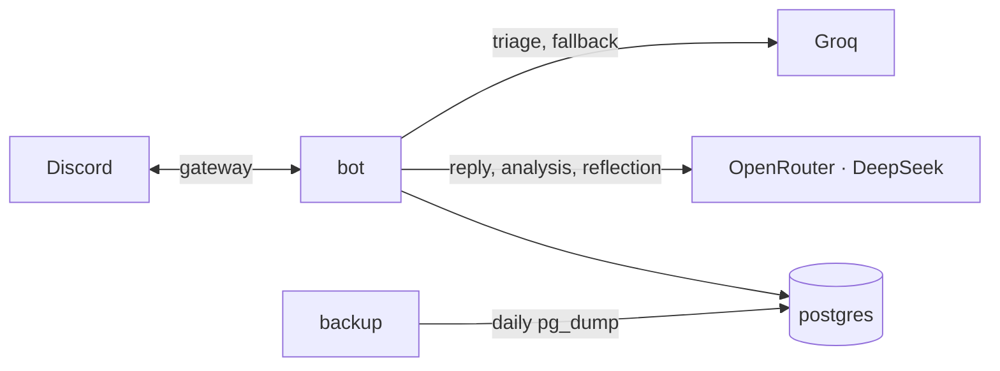
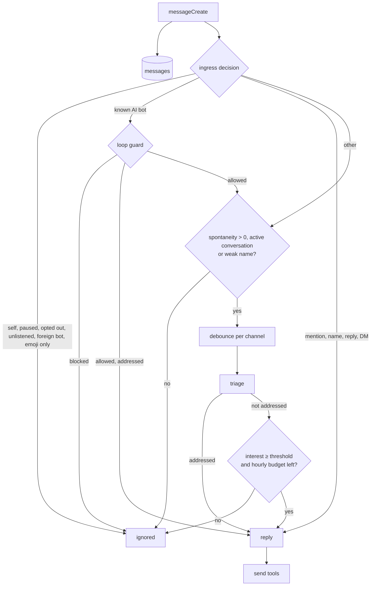
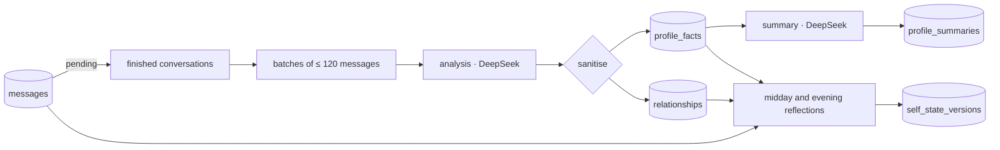

# Architecture

## Services



| Service | Image | `mem_limit` | Role |
|---|---|---|---|
| `postgres` | `archive-9-postgres:18`, built on the host from `docker/postgres.Dockerfile` (`postgres:18-alpine` with pgvector) | 1 GB | database, on an internal network with no internet access |
| `bot` | `ghcr.io/<owner>/archive-9-bot` | 512 MB | Discord process |
| `piper` | `archive-9-piper:1`, built on the host from `docker/piper.Dockerfile` | 384 MB | text to speech (Piper, voice `fr_FR-upmc-medium`) over HTTP, on an internal network shared with the bot only |
| `backup` | `postgres:18-alpine` | 64 MB | `pg_dump` at startup then every 24 h, keeps `BACKUP_KEEP_DAYS` days |

Deployment is pull-based: the host checks `main` every minute, pulls the `bot` image only and runs `docker compose up -d --remove-orphans`, which recreates only what changed. Nothing on the host is reachable from the internet. `postgres` and `backup` are updated by hand.

Postgres settings: `shared_buffers=256MB`, `effective_cache_size=640MB`, `work_mem=4MB`, `maintenance_work_mem=64MB`, `max_connections=30`.

## Packages

| Package | Content |
|---|---|
| `core` | pure domain logic: ingress decision, bot loop guard, debouncer, transcript formatting, name matching, conversation grouping, relationship steps, self state limits, job schedules, fragment references, search query parsing, the sprite |
| `ai` | provider setup, fallback runtime with cooldowns, triage, reply, analysis, summary and reflection tasks, prompts |
| `db` | Drizzle schema, migrations and repositories |
| `config` | shared tsconfig and ESLint |

Dependencies flow one way: `apps → packages`. `core` depends on no other package. `db` is the only one that runs SQL.

Each package exports its `.ts` sources directly. Node runs them through type stripping, which requires erasable TypeScript syntax (`erasableSyntaxOnly`): no `enum`, no `namespace`.

## Bot startup

1. Environment variables are read and validated with zod. The process exits if one is missing.
2. Pending Drizzle migrations are applied.
3. The bot logs in to Discord.
4. A health server listens on `HEALTH_PORT`: `GET /health` returns 200 when Discord is connected and the database responds, 503 otherwise. Docker uses it as the healthcheck.

## Message flow



- Messages from listened channels (and their threads) and DMs are stored, along with edits, deletions and reaction counts. DMs are learned from like any channel. Opted-out members are never stored.
- **Private DMs**: `/mp-prives` keeps a member's DMs out of the archive (theirs and ARCHIVE-9's answers), and can erase the earlier ones with the facts learned only from them. ARCHIVE-9 still answers, from the conversation read on Discord; those replies show in the journal to that member only, admins included. Everyone else gets a fixed line, added by the code to ARCHIVE-9's first reply in their DMs, saying DMs are archived and how to keep them out.
- **Images**: attachments and link previews (Tenor, Giphy…) are stored in `message_images`, at most 4 per message. ARCHIVE-9 looks at each one once, as it needs it: before a reply, the images of the last 30 minutes in the channel; before an analysis, those of the batch. A GIF is read as three moments (start, middle, end). What it understood is kept and shown in transcripts as `[image : …]`, for replies, analysis and search. Spending is capped by `VISION_DAILY_BUDGET_USD` (0.1 by default) over 24 hours; an image that couldn't be read is not retried. The images of a private DM are looked at on the spot and never stored.
- The server's rule for bots: in the **AGENTS category** (`AGENTS_CATEGORY_ID`, its channels and their threads) they may speak freely. Everywhere else, ARCHIVE-9 still archives everything but only answers a human who mentions it with @ (a reply that pings it counts, a reply without the ping doesn't), without triage; names, follow-ups, other bots and unprompted interventions are ignored there. DMs are answered as before. Without `AGENTS_CATEGORY_ID`, no channel is free.
- In AGENTS, every bot counts as an AI agent, listed in `KNOWN_AI_BOT_IDS` or not, and stays one afterwards. Elsewhere, bots outside that list are ignored.
- In AGENTS, a message is **addressed** to ARCHIVE-9 without AI when it mentions it, contains a strong name (`BOT_ALIASES`, ignored after an apostrophe), replies to one of its messages, is a DM, or comes from the person it just answered within 2 minutes with nobody else speaking in between.
- A weak name (`BOT_SOFT_ALIASES`, e.g. « archive », also a common verb) sends the message to triage instead.
- In observer mode, messages still go to triage for 3 minutes after ARCHIVE-9 spoke in the channel.
- **Triage** gets the last 10 messages and a note computed by the code (whether ARCHIVE-9 is in the conversation, who it answered, who wrote since, who the message replies to, weak name match), and returns `{ addressed, interest, reason }`, validated with zod. `addressed` means the message is for ARCHIVE-9; `interest` (0–10) is the value of an unprompted intervention. Within a burst, the last human message stays the target even if a bot answers right after.
- Transcripts show who each reply is for (`↪ à Dave`) and tags as `@Name`; ARCHIVE-9's own tag reads `@ARCHIVE-9 (toi)`. When a message tags someone else first and only names ARCHIVE-9, the reply prompt says the request is for that person.
- **Reply** gets the last 20 messages (with their images), the participants' profile summaries and relationships, up to 6 of their facts closest in meaning to the message (from the search index, see below), the current self state, the profiles of people the message tags or names (by name, former name, first name of 3+ letters or initials such as "jp", up to 5), and a short memory: what the target author said in the last 6 hours outside those 20 messages (other channels, DMs) with ARCHIVE-9's replies, up to 10 messages. All of it is built by the code. It also gets the skills that apply (see below). The model speaks only by calling `sendReply` or `sendMessage`; no call means silence. Tools are bound to the current channel and target message.
- The bot loop guard (bots are only answered in AGENTS) allows at most 10 consecutive replies to bots in a channel without a human, and one reply to a bot per 10 s.
- While the reply is being generated, the typing indicator is shown.

### Tools

Every reply gets the same tool set, so the definitions stay identical and cacheable. A reply runs up to 6 steps and stops at the first `sendReply`, `sendMessage` or `staySilent`.

| Tool | Tier | Notes |
|---|---|---|
| `sendReply`, `sendMessage`, `addReaction`, `staySilent` | speaking | bound to the current channel and target message |
| `readChannel` | free | last messages (up to 30) of a listened channel the requester can read; a private channel is only read back in DM |
| `findMember` | free | ID, name and summary from the member directory |
| `searchArchives`, `readFragment`, `readDossier`, `myStats`, `howIWork` | memory | read access to the whole memory: the search engine (words and meaning), one fragment with its versions and tidy history, a whole dossier by drawer, its real numbers (counts, database size, AI costs, version and changelog, settings), and the sections of this document (copied into the image) |
| `joinVoice`, `leaveVoice` | voice | joins the voice channel the requester is in, or leaves; only when a member asks |
| `noteForCreator` | notebook | writes in its notebook for the owner (what it lacks, what it would change in itself), 3 a day |
| `myFacts`, `forgetMyFacts`, `correctMyFact` | own profile | the requester's own facts only, named by identifier or rank; removal needs a reason; a correction supersedes the fact with the member's version (nature `fact`), and both go to `fact_corrections` |
| `noteFeedback` | feedback | about ARCHIVE-9's own behaviour, 5 a day per member; see below |
| `myPreferences`, `setMyPreference`, `forgetMyPreference` | own preferences | how the requester wants to be treated, 10 per member |
| `createSkill`, `deleteSkill`, `listSkills` | skills | see below |
| `createChannel`, `renameChannel`, `renameMember`, `setRole`, `pinMessage`, `createThread`, `createPoll` | controlled | see below; a poll has 2 to 10 answers, 1 hour to 7 days |

Controlled actions are checked by the code before anything reaches Discord:

- only when ARCHIVE-9 was addressed by a human, on the home server (never in an unprompted intervention, never for a bot);
- at most 5 per action type over a sliding hour;
- the requester needs the matching Discord permission (Manage Channels, Manage Nicknames or Change Nickname for themselves, Manage Roles, Pin Messages, Create Public Threads, Create Polls), inside AGENTS too;
- Discord's hierarchy: the requester's top role must be above the target member's, and above the role given or removed; never on the owner, bots or opted-out members;
- roles: never `@everyone`, integration roles, or roles with a moderation or management permission.

Nothing runs right away, AGENTS included. The plan is posted first, with the exact Discord API requests it will send (`PATCH /channels/… {"name":…}`), under **Confirmer** / **Annuler** buttons that only the requester can use, for 10 minutes; all checks run again on confirmation. Sending messages and reactions is how it speaks and needs no confirmation.

Every attempt is stored in `actions_log` (pending, done, refused, failed, cancelled, undone) with the value needed to undo it. Bans, kicks, timeouts, deletions and permission changes have no tool.

### Feedback, skills and preferences

ARCHIVE-9 files each request where it belongs:

- **Feedback**: about how it behaves in general, or a logic it should follow ("tu es trop agressif avec les gens"). Stored in `feedback` and shown in every reply until the evening reflection weighs it (several people count more than one, trust in the author counts, anything against its identity or limits is ignored). The reflection turns it into **resolutions** in the self state, 8 at most, 2 added or removed per day, and records a verdict for each piece (adopted, partial, ignored) with its reason; the site shows that history. Admins can also comment on its mind from the site: it answers right away and the comment joins the feedback.
- **Skills**: a behaviour for the whole server, fun or about a topic (below).
- **Preferences**: how one member wants to be treated ("vouvoie-moi"), set and removed by that member only, shown in replies when they take part, listed in `/mondossier`.

### Skills

Members teach ARCHIVE-9 skills by asking it in conversation or on the site; the model picks the name, the kind, the triggers and the scope.

- **Permanent**: given to every reply, 10 at most.
- **Triggered**: given when the target message contains one of its triggers (whole words, case and accents ignored), 10 per reply at most, most used first.
- Either kind can be **temporary**: the model gives a local end time (`21:00`, or a date and time), at most a week ahead, and the skill stops applying then. An expired skill frees its name.
- A skill can be scoped to one channel (and its threads) or to the member who asked for it.
- 10 active skills per member, 200 in total, names unique. Edited by its author or an admin from the site; every edit goes through the same checks and the old version is kept in `skill_revisions`.
- Checked first by the code (length, triggers, no `@everyone`, no rule changes, no global silence, no identity change, no spam), then by the triage model. When no model can check it, the skill is refused.
- A skill is counted as used each time it was given to a reply that spoke. Deleted by its author or an admin, and when its author opts out.

### AI providers

Each task has an ordered chain of `provider:model`, overridable with `AI_ROUTE_*`:

| Task | Default chain |
|---|---|
| `triage` | `groq:openai/gpt-oss-20b` → `openrouter:openrouter/free` |
| `reply` | `openrouter:deepseek/deepseek-v4.1-flash` → `groq:openai/gpt-oss-120b` |
| `analysis` | `openrouter:deepseek/deepseek-v4.1-flash` |
| `reflection` | `openrouter:deepseek/deepseek-v4.1-flash` |
| `vision` | `openrouter:deepseek/deepseek-v4.1-flash` → `groq:meta-llama/llama-4-scout-17b-16e-instruct` |

Speech recognition in voice channels goes straight to Groq (`whisper-large-v3-turbo`, French, 0.04 $ an hour of audio, 10 s billed at least per clip), recorded as the `voice` task and capped by `VOICE_DAILY_BUDGET_USD` (0.2 by default) over 24 hours.

Embeddings for the search index go straight to OpenRouter's embeddings endpoint (`EMBEDDING_MODEL`, `baai/bge-m3` by default, 1024 dimensions) and are recorded as the `embedding` task.

- OpenRouter requests use `data_collection: "deny"`, fp8 or better quantisation, and the upstream order from `OPENROUTER_PROVIDER_ORDER`.
- A model is skipped while it cools down after a 429 (`retry-after` or Groq reset headers), a 402, a 5xx or a network error, or when its remaining minute token budget is below the request estimate.
- When a fallback model answers, `-# noyau-<model>` is appended to the message (`/config mention-secours`).
- `REPLY_DAILY_BUDGET_USD` (default 1) caps reply costs over 24 h. Past it, only humans who addressed ARCHIVE-9 get an answer, from free models only (Groq, OpenRouter `:free`).
- When every model fails and the bot was addressed, it answers with a pre-written line, without AI.
- Every call is stored in `ai_usage` with tokens, cost, upstream provider and the Discord messages it produced.

### Voice

- When a member asks, ARCHIVE-9 joins the voice channel they are in (one at a time) and says hello with how to talk to it. The connection uses `@discordjs/voice` with DAVE end-to-end encryption (`@snazzah/davey`) and Opus through `opusscript`.
- Each person is heard on their own: their audio ends after 0.9 s of silence, clips under 0.6 s are dropped, longer than 30 s are cut. A clip is turned into 16 kHz mono and transcribed in French.
- It answers a sentence that starts with its name (« archive », a close spelling, after a filler like « euh »), and the person it just answered within 25 seconds if nobody else spoke. Anyone else within those 25 seconds goes to triage, which decides whether the sentence is for it.
- The reply is the normal one, with the voice transcript (24 lines at most) as the conversation and a note that it is read aloud: short, spoken, no markdown, emoji or links. The text is cleaned (tags become names, links « le lien ») and spoken by Piper, resampled to 48 kHz stereo for Discord. A sentence with its name heard while it is answering waits for its turn; other sentences are only kept in the transcript.
- It leaves when asked, when no human is left in the channel, or after 15 minutes without anyone speaking. Nothing said in voice is stored: no audio, no transcript, no learning. AI usage is recorded as for text.

## Learning

Background jobs run in the bot process every 5 minutes.



### Analysis

- Pending messages are grouped into conversations (same channel, no silence longer than 15 minutes). A conversation is analysed once it is finished, after 15 minutes of silence. One that keeps going is analysed anyway when its first message is an hour old, and so are all ongoing ones when a member has 25 pending messages or before a reflection; the last 10 minutes are then left for later.
- Small conversations share a batch; long ones are split. Each conversation comes with up to 6 earlier, already analysed messages as context.
- The model gets the participants (summary, relationship, up to 40 current facts with short references `F1`, `F2`…), the drawers (shared ones and the participants' own) and the transcripts with reactions and images, and returns facts, retractions and relationship changes as JSON validated with zod.
- The output is sanitised by the code before anything is written: facts must be about a listed participant, other than ARCHIVE-9 and not opted out, and cite messages of the batch; a self-declared `fact` cited from someone else's message becomes `reported`, with its reporter; a correction can only replace a fact of the same member; a personal drawer only takes its member's facts; at most 20 facts per batch.
- A new fact that reads almost like a current one of the same member (trigram similarity ≥ 0.6) isn't added: the existing one gets its sources and the higher confidence.
- Affinity goes from −50 to 50 (starting at 0) and trust from 0 to 50 (starting at 25), with one decimal. Each change is a step of 0.1 to 0.5, and each axis moves by 1 at most per member over 24 hours, counted from when the conversation happened. Relationship rows created by the analysis don't count as an introduction.
- A batch is written in one transaction, which also marks its messages as analysed. Then each member whose facts changed gets a new summary (≤ 700 characters, read by the reply prompt) and a tagline (one line in ARCHIVE-9's voice, shown in `/mondossier`). A member with no fact left loses their summary.
- Utility bots get no profile. Known AI bots do.
- The server has its own profile: a `members` row keyed by the guild ID with `is_server`, listed among the participants of every batch. Group-level facts go there (history, events, traditions, collective jokes, vocabulary), never as `reported`, and it has no relationship. Its summary (≤ 1000 characters) leaves out the fixed description of the server (`packages/ai/src/prompts/server.ts`), which is part of the persona and of the analysis and summary instructions.
- Analysis spending is capped by `ANALYSIS_DAILY_BUDGET_USD` over the last 24 hours. A failed batch stays pending and is retried an hour later. A Postgres advisory lock keeps two processes from analysing at once.
- After each run, `pg_notify('archive9', …)` announces the change.

### Reflection

Twice a day, at local hours set on the site (Réglages, 12:00 and 22:00 by default), after a last analysis.

- **Midday**, a short one: what happened since the last reflection (14 hours at most, up to 100 messages). It rewrites the mood and the notes and may add or remove one running joke. Opinions and resolutions don't move.
- **Evening**, the big one: the last 24 hours, up to 150 messages, conversations it took part in first, plus the facts learned, the relationship changes and the pending feedback. It returns a new mood, notes, additions and removals for its opinions, running jokes and resolutions (2 of each at most, 10 entries per list), and a verdict per piece of feedback. Then the tidy rereads dossiers (below).
- Both pick a face for the site among a fixed list (neutral, amused, curious, tired, annoyed, glitch).
- The evening one also reads what it couldn't do that day (replies where a tool refused or failed), its active skills and its notebook with the owner's answers. It may give itself one skill (same checks as a member's, itself as author) and write up to 3 notes in its notebook: what it lacks (`gap`) or would change in itself (`wish`). The owner answers each note on the site (done, later, declined); open and recently answered notes are read back every evening, so it doesn't ask twice.
- Each reflection is a new row in `self_state_versions`, numbered in half steps: day N at midday is N, the evening is N,5; a rollback takes the next half step. Nothing happened: no reflection. A failure is retried an hour later.
- When the face changes, the Discord avatar (the sprite with that face, 512 px) and the profile banner (the visor blown up) follow, drawn by the code.

### Fragments and drawers

- Each fact has a reference drawn by the database, shown as `#K7QX3M` (6 characters, Crockford's alphabet, unique among current facts), and an arrival number in its dossier. Every later version (a correction, a rewrite, a merge) keeps both. The site shows `F001`, `F002`… as the rank among current facts, so the last one is the count; a deletion closes the gap, the reference never changes.
- Facts are filed in drawers (`fact_categories`): 13 shared ones to start with, and drawers ARCHIVE-9 opens for one person only (`member_id`), at most 6 per dossier.

### Tidy

- After the evening reflection, ARCHIVE-9 rereads whole dossiers: those whose facts changed since their last tidy, plus the 5 left unread the longest, so every dossier is reread within a couple of weeks (0.05 $ a night at most). It gets every current fact with its rank, drawer, nature, confidence, sources and date, and the pairs the code finds close (trigram similarity ≥ 0.4, or vectors ≥ 0.86).
- It may merge duplicates (same nature only; the kept fact becomes a new version with every source and the best confidence), delete noise, rewrite a badly worded fact, move facts to the right drawer, and open a personal drawer when at least 3 facts share a theme. The code checks every reference and keeps one operation per fact.
- Every operation is logged in `fact_operations` with its reason and what the fact said before. With the dry run setting (Réglages, on by default), merges and deletions are only `planned`: an admin applies or dismisses them on the site, and they are checked again then. Planned operations nobody looked at are dismissed after 30 days.
- A one-shot big tidy over every dossier can be started from the site (0.50 $ at most), with its progress shown live.

### Search index

When Postgres has pgvector, the bot creates `fact_embeddings` (one 1024-dimension vector per current fact, HNSW index) at start-up and embeds new facts every 5 minutes, 64 at a time. It only serves finding: the drawer, nature and confidence stay on the fact. It is used for search by meaning, for the facts recalled in replies and for the tidy's lookalike pairs. Without pgvector, everything works and search is by words only.

### Site requests

Corrections of facts, comments on its mind, skills taught or edited on the site and the big tidy go through `site_requests`. The site saves what it can at once (a correction is applied immediately), then queues the request; the bot hears it through the same `pg_notify` channel (and polls every 30 s), works on it, and appends each step to the row, which the page shows live. A fact correction costs one analysis call: it retracts the facts the correction contradicts, may add up to two, rewrites the summary and says what it understood. At most 30 requests per person a day and 200 using the AI for everyone; past that, corrections still apply without the follow-up. While a request runs, its window on the site can't be closed.

### Purge

Every 6 hours, raw messages older than `MESSAGE_RETENTION_DAYS` (30 by default) are deleted, except those a fact or a relationship change cites as its source. Facts, summaries and relationships are kept.

### History backfill

`src/backfill.ts` reads the history of the listened channels (and their active threads, not DMs) through the Discord REST API, stores the messages that are missing and analyses them. It skips opted-out members and command answers, and never goes further back than the retention period.

```sh
docker compose exec bot node src/backfill.ts --days 30 --dry-run    # counts and estimates the cost
docker compose exec bot node src/backfill.ts --days 30 --max-cost 0.5
docker compose exec bot node src/backfill.ts --days 30 --max-cost 0.1 --channel <id>
docker compose exec bot node src/backfill.ts --days 30 --max-cost 0.5 --reflect
docker compose exec bot node src/backfill.ts --days 30 --max-cost 0.1 --server
```

Batches run one after the other, about 30 seconds each, so a month of history takes most of an hour; summaries are refreshed every 15 batches, so an interrupted run keeps what it did and a rerun finishes the rest. `--reflect` then reads the whole period (up to 400 messages, the conversations with the most reactions first, plus up to 60 facts) to build a first self state, with up to 5 additions per list, and returns up to 15 facts for the server's profile. `--server` does the same reading for the server's profile only and leaves the self state as it is. It is saved as an `initial` version, so the evening reflection still runs that day.

It holds the analysis lock for the whole run. When `--max-cost` is reached, the remaining backfilled messages are kept but marked as analysed, so the bot doesn't analyse them on its own budget. Useful at first start, after adding a channel, or after the bot was offline.

## Version and status

- The image is built with the commit (`GIT_SHA`), turned into an invented version name such as *Novahe*: three syllable lists picked by the commit's first bytes, so a commit always gets the same name. Shown as `Novahe (a1b2c3d)`, or `dev` locally. Each AI call stores the version that made it, so Diagnostic shows the version that wrote a message. The reply prompt says which version is running and since when.
- The bio (the application's description) is a fixed text with the version and the site's address (`SITE_URL`), updated at start-up when it differs.
- **Changelog**: when a new version starts, the bot reads the commits since the previous one from GitHub's public API (`GITHUB_REPO`), sorts them by the files they touch (the bot, the site, both), and has the triage model write them as a list with a short comment (raw commit titles when it fails). The site's number (x.y.z) goes up with each version that touches it: a minor for a feature, a patch otherwise. Stored in `releases`; the site reads them from there, never from GitHub.
- Outgoing messages pass through a last cleanup: HTML written by habit becomes Discord markdown and a bare domain gets its `https://`.
- The profile status is a line written by the triage model from the current self state, with an angle drawn by the code (mood, absurd thought, fake procedure…) and the last 5 lines to avoid repeats. It changes every 4 to 6 hours, and shows a fixed line while paused.

## Site

`apps/web`: a Hono server (API, Better Auth, the built client) and a React client built by Vite. Pixel art look: Silkscreen and JetBrains Mono, served by the site itself.

- **Access**: Discord login with the `identify` scope only. Better Auth needs an email, so the user row gets `<discord id>@discord.invalid`, and the Discord ID is read back from it (an `input: false` field can't come from the profile). OAuth tokens are dropped before they are stored. The whole login is tested end to end against a fake Discord. A session is only created for someone the bot sees on the server, and every API call checks it again: leaving the server closes the site at once.
- **Who is on the server**: the bot syncs `members.in_guild` from the guild member list at start-up, then on every join and leave.
- **Admins**: `SITE_OWNER_ID` is always admin; the other admins are in `site_admins`.
- **Database**: the site connects as `archive9_web`, created by the bot after its migrations from `WEB_DB_PASSWORD`. It can read every table but only write its login tables and `site_admins`. The site never migrates.
- **Security**: strict Content-Security-Policy (`'self'` only), HSTS, `X-Frame-Options: DENY`, `Referrer-Policy: same-origin`, `HttpOnly` / `Secure` / `SameSite=Lax` cookies, Better Auth origin checks and rate limit, client IP from `CF-Connecting-IP`.
- **Not indexed**: `robots.txt` disallows everything except the home page and its preview image for `Discordbot`; every response has `X-Robots-Tag: noindex, nofollow, noarchive, nosnippet`, and the page has the matching `meta robots`.
- **Link preview**: Open Graph tags built from `SITE_URL` when the page is served, with a 1200×630 card. The card, favicon and touch icon are drawn from the sprite by `apps/web/scripts/icons.ts`.
- **Network**: no published port. The `tunnel` service (`cloudflared`, pinned version) reaches `web:3000`; the Cloudflare public hostname points there.
- **Pages**: login, a start-up sequence once per session, home (Noyau), Dossiers (instant search on current and former names, 7 sorts), Archives (the search engine, below), a dossier per member (facts in drawers, dated, with their source shown on the site from the archived message when its channel is public; the member, or an admin, can correct or remove a fact and follow ARCHIVE-9's follow-up live), Relations (a map of affinity against trust, a podium, this week's changes with their source), Esprit (self state with dates, resolutions, feedback pending and decided, history; admins comment and roll back), Skills (teach, edit, history), Journal (replies with trigger, context, reasoning, steps and cost; what it learned with why and how; actions; triage with its reasoning; errors grouped with their attempts) and Système (costs and tokens by day, task, model and person; versions of the core and the site). Admin is the only admin page, in tabs: Réglages (pause, spontaneity, reflection hours, fallback tag, tidy dry run, listened channels), Technique (its notebook, which the owner answers; every piece of feedback with its verdict; what the tidy did or waits to do, with apply and dismiss; the drawers it opened; counts and sizes of the database) and Accès (owner only: who is admin, with Discord username and ID).
- **Search**: one bar for everything: fragments, messages (public channels, and one's own DMs; all DMs for admins), image descriptions, dossiers, skills, its replies and relationship changes. Free words use French full-text search with accents ignored, plus trigrams for typos and parts of words; `"phrase"`, `@name` (current or former name, username), `#K7QX3M`, `F012` with a person, `tiroir:`, `nature:`, `type:`, `après:` and `avant:` filter. Matches are highlighted and grouped by kind. Profile pictures are the Discord avatars, fetched at 16 px and drawn with hard pixels. Pages update live: Postgres triggers on the tables the site shows send `pg_notify('archive9', {type})`, the site keeps one `LISTEN` connection and pushes the change type to open pages over Server-Sent Events (`/api/live`, members only, a ping every 25 s for the tunnel); pages refetch what changed. Only the kind of change travels, never content. Polling stays as a fallback.
- **Voice**: ARCHIVE-9 speaks in the first person on public pages; buttons talk to the reader; the settings page talks about it in the third person.
- **Decisions**: the bot stores what it decided about every message it sees (`decisions`, 14 days): ignored with the reason, silent with the triage interest, or answered with its context, reasoning, tool steps and what it sent. A DM reply shows only to its member and admins; Triage decisions keep what the model read and its reasoning, so the journal can show them.
- **Writes from the site**: same-origin only; settings saved there reach the bot within 30 s. The site's database user can also insert and update facts, corrections, settings, self state versions, site requests and skills (to close one).

## Commands

| Command | Who | Effect |
|---|---|---|
| `/archive-9` | everyone | introduction |
| `/mondossier` | everyone | own profile, ephemeral: tagline, summary, relationship, latest facts with their nature; offers to opt back in when opted out |
| `/serveur` | everyone | what ARCHIVE-9 knows about the server: its fixed description and learned summary |
| `/mp-prives` | everyone | keeps their DMs out of the archive, optionally erasing the earlier ones and the facts learned only from them; run again to let DMs be archived again |
| `/oublie-moi` | everyone | spells out what will be erased (with the member's numbers), then on confirmation deletes their messages (DM conversations entirely), facts, summary, relationship, corrections, feedback, preferences and skills, and opts them out: no more archiving, no more replies. Run again when opted out, it offers to come back, starting from zero |
| `/pause`, `/reprendre` | Manage Server | stop or resume all replies |
| `/config etat \| ecoute \| spontaneite \| mention-secours` | Manage Server | show the version, settings and current status; toggle the current channel, spontaneity level, fallback tag |
| `/skills [supprimer]` | everyone | list the skills (author, triggers, use count); delete one (own, or any for an admin) |
| `/actions` | Manage Server | last 10 controlled actions, with an undo button for each |

Guild commands are registered at start-up and again whenever the bot joins the server.
| Diagnostic (message menu) | everyone | version, model, provider, triage reason, tokens, cost and latency behind one of ARCHIVE-9's messages |

### Spontaneity

Unprompted interventions (only in AGENTS) depend on `/config spontaneite`:

| Level | Interest threshold | Max per channel per hour |
|---|---|---|
| 0 · observateur | — | 0 |
| 1 · discret (default) | 8 | 2 |
| 2 · normal | 6 | 5 |
| 3 · bavard | 4 | 12 |

The hourly budget is enforced by the code. Unprompted interventions don't show the typing indicator, since they may end in silence.

## Data

Discord IDs are stored as `text`. Dates are `timestamptz`.

| Table | Content |
|---|---|
| `members` | members and bots seen on the server, nickname history, opt-out, private DMs, whether they are on the server now, last tidy; one row for the server's own profile |
| `messages` | raw messages from listened channels, with reactions and analysis status |
| `profile_facts` | one learned fact per row: reference, arrival number, category, nature, confidence, sources, reporter; a new version replaces a row through `superseded_by` and keeps its reference and number |
| `profile_summaries` | short summary of each profile, used in replies, and a tagline |
| `relationships` | ARCHIVE-9's affinity (−50 to 50), trust (0 to 50) and feeling toward each member |
| `relationship_events` | history of relationship changes |
| `feedback` | members' feedback on ARCHIVE-9's behaviour (and admins' comments from the site), with the evening reflection's verdict |
| `member_preferences` | how each member asked to be treated |
| `fact_corrections` | facts a member took off their own profile, with their reason; shown to the analysis so they aren't learned again |
| `self_state_versions` | ARCHIVE-9's evolving state, one version per row, numbered in half steps |
| `fact_categories` | the drawers facts are filed in, with who opened them and why; a personal one belongs to one member |
| `fact_operations` | what the tidy did or plans to do to facts: move, rewrite, merge, delete, personal drawer, with the reason and the text before |
| `message_images` | images and GIFs seen in messages, with what ARCHIVE-9 understood of each |
| `capability_gaps` | its notebook for the owner: what it lacks and would change in itself, with the owner's answer |
| `fact_embeddings` | vectors of current facts for search by meaning (only with pgvector, created by the bot) |
| `site_requests` | what the site asked ARCHIVE-9, with each step it took |
| `releases` | versions of the core and the site, with their changelog |
| `skill_revisions` | earlier versions of edited skills |
| `skills` | rules taught by members: name, kind (`permanent` or `triggered`), triggers, scope, author, use count |
| `actions_log` | Discord actions: tool, tier, status (pending, done, refused, failed, cancelled, undone), refusal reason, value before the change, undo |
| `ai_usage` | AI calls: task, model (and the one a router really served), provider, tokens, cost, duration, error cause, triage reason or tools used, produced messages |
| `settings` | settings editable at runtime, plus the running version and status lines |
| `web_user`, `web_session`, `web_account`, `web_verification` | site logins (Better Auth), without email or OAuth tokens |
| `site_admins` | site admins named by the owner |
| `decisions` | what ARCHIVE-9 decided about each message it saw, with the why of each reply; kept 14 days |

Deleting a member cascades to their messages, facts, summary and relationship.

The schema is in [`packages/db/src/schema.ts`](../packages/db/src/schema.ts) and migrations in [`packages/db/migrations`](../packages/db/migrations).

## CI

| Job | Trigger | Steps |
|---|---|---|
| `check` | PRs and pushes to `main` | install, lint, typecheck, tests with coverage against Postgres 18 |
| `secrets` | PRs and pushes to `main` | gitleaks over the full history |
| `image` | after `check` and `secrets` | `linux/amd64` build, pushed to GHCR (`latest` and SHA) from `main` only |

Coverage threshold: 80% on `packages/core` and `packages/ai`.
