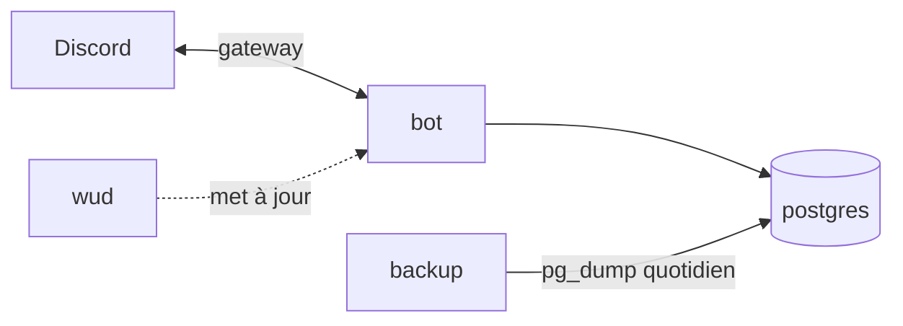

# Architecture

## Services

| Service | Image | `mem_limit` | Rôle |
|---|---|---|---|
| `postgres` | `postgres:18-alpine` | 1 Go | base de données, sur un réseau interne sans accès à Internet |
| `bot` | `ghcr.io/<owner>/archive-9-bot` | 384 Mo | process Discord |
| `backup` | `postgres:18-alpine` | 64 Mo | `pg_dump` au démarrage puis toutes les 24 h, rotation sur `BACKUP_KEEP_DAYS` jours |
| `wud` | `getwud/wud:9` | 128 Mo | met à jour `bot` quand une nouvelle image est publiée |

Réglages de Postgres : `shared_buffers=256MB`, `effective_cache_size=640MB`, `work_mem=4MB`, `maintenance_work_mem=64MB`, `max_connections=30`.

## Paquets

Les dépendances vont dans un seul sens : `apps → packages`. `core` ne dépend d'aucun autre paquet. `db` est le seul à faire du SQL.

Chaque paquet expose directement ses sources `.ts`. Node les exécute via le *type stripping*, ce qui impose une syntaxe TypeScript effaçable (`erasableSyntaxOnly`) : pas d'`enum` ni de `namespace`.

## Démarrage du bot

1. Lecture et validation des variables d'environnement (zod). Le process s'arrête si une variable manque.
2. Application des migrations Drizzle en attente.
3. Connexion à Discord.
4. Serveur de santé sur `HEALTH_PORT` : `GET /health` renvoie 200 si Discord est connecté et que la base répond, 503 sinon. Il sert au healthcheck Docker.

## Données

Les ID Discord sont stockés en `text`. Les dates sont en `timestamptz`.

| Table | Contenu |
|---|---|
| `members` | membres et bots vus sur le serveur, historique des pseudos, opt-out |
| `messages` | messages bruts des salons écoutés, avec leurs réactions et leur statut d'analyse |
| `profile_facts` | une info apprise par ligne : catégorie, nature, confiance, sources, auteur du signalement ; une correction remplace une ligne via `superseded_by` |
| `profile_summaries` | résumé court de chaque fiche |
| `relationships` | affinité (−100 à 100), confiance (0 à 100) et ressenti d'ARCHIVE-9 envers chaque membre |
| `relationship_events` | historique des variations de relation |
| `self_state_versions` | état évolutif d'ARCHIVE-9, une version par ligne |
| `skills` | règles de comportement durables créées par les membres |
| `actions_log` | actions Discord tentées, refus, valeur précédente, annulations |
| `ai_usage` | appels IA : tâche, modèle, fournisseur, tokens, coût, durée, messages produits |
| `settings` | réglages modifiables à chaud |

Supprimer un membre supprime en cascade ses messages, ses infos, son résumé et sa relation.

Le schéma est dans [`packages/db/src/schema.ts`](../packages/db/src/schema.ts) et les migrations dans [`packages/db/migrations`](../packages/db/migrations).

## CI

| Job | Déclencheur | Étapes |
|---|---|---|
| `check` | PR et push sur `main` | install, lint, typecheck, tests avec couverture sur un Postgres 18 |
| `secrets` | PR et push sur `main` | gitleaks sur tout l'historique |
| `image` | après `check` et `secrets` | build `linux/amd64`, push sur GHCR (`latest` et SHA) uniquement depuis `main` |

Seuil de couverture : 80 % sur `packages/core` et `packages/ai`.
