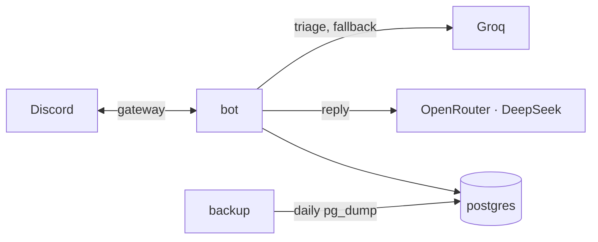
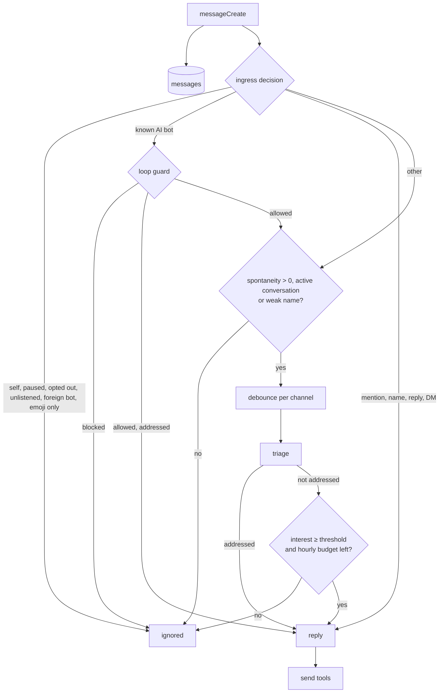

# Architecture

## Services

| Service | Image | `mem_limit` | Role |
|---|---|---|---|
| `postgres` | `postgres:18-alpine` | 1 GB | database, on an internal network with no internet access |
| `bot` | `ghcr.io/<owner>/archive-9-bot` | 384 MB | Discord process |
| `backup` | `postgres:18-alpine` | 64 MB | `pg_dump` at startup then every 24 h, keeps `BACKUP_KEEP_DAYS` days |

Postgres settings: `shared_buffers=256MB`, `effective_cache_size=640MB`, `work_mem=4MB`, `maintenance_work_mem=64MB`, `max_connections=30`.

## Packages

| Package | Content |
|---|---|
| `core` | pure domain logic: ingress decision, bot loop guard, debouncer, transcript formatting, name matching |
| `ai` | provider setup, fallback runtime with cooldowns, triage and reply tasks, prompts |
| `db` | Drizzle schema, migrations and repositories |
| `config` | shared tsconfig and ESLint |

Dependencies flow one way: `apps → packages`. `core` depends on no other package. `db` is the only one that runs SQL.

Each package exports its `.ts` sources directly. Node runs them through type stripping, which requires erasable TypeScript syntax (`erasableSyntaxOnly`): no `enum`, no `namespace`.

## Bot startup

1. Environment variables are read and validated with zod. The process exits if one is missing.
2. Pending Drizzle migrations are applied.
3. The bot logs in to Discord.
4. A health server listens on `HEALTH_PORT`: `GET /health` returns 200 when Discord is connected and the database responds, 503 otherwise. Docker uses it as the healthcheck.

## Message flow

- Messages from listened channels (and their threads) are stored, along with edits, deletions and reaction counts. DMs are answered but never stored. Opted-out members are never stored.
- A message is **addressed** to ARCHIVE-9 without AI when it mentions it, contains a strong name (`BOT_ALIASES`, ignored after an apostrophe), replies to one of its messages, is a DM, or comes from the person it just answered within 2 minutes with nobody else speaking in between.
- A weak name (`BOT_SOFT_ALIASES`, e.g. « archive », also a common verb) sends the message to triage instead.
- In observer mode, messages still go to triage for 3 minutes after ARCHIVE-9 spoke in the channel.
- **Triage** gets the last 10 messages and a note computed by the code (whether ARCHIVE-9 is in the conversation, who it answered, who wrote since, who the message replies to, weak name match), and returns `{ addressed, interest, reason, toolPacks }`, validated with zod. `addressed` means the message is for ARCHIVE-9; `interest` (0–10) is the value of an unprompted intervention. Within a burst, the last human message stays the target even if a bot answers right after.
- Transcripts show who each reply is for (`↪ à Dave`).
- **Reply** gets the last 20 messages, the participants' profile summaries and relationships, and the current self state, all built by the code. The model speaks only by calling `sendReply` or `sendMessage`; no call means silence. Tools are bound to the current channel and target message.
- The bot loop guard allows at most 3 consecutive replies to bots in a channel without a human, one reply to a bot per 30 s, and 40 per day.
- While the reply is being generated, the typing indicator is shown.

### AI providers

Each task has an ordered chain of `provider:model`, overridable with `AI_ROUTE_*`:

| Task | Default chain |
|---|---|
| `triage` | `groq:openai/gpt-oss-20b` → `openrouter:openrouter/free` |
| `reply` | `openrouter:deepseek/deepseek-v4.1-flash` → `groq:openai/gpt-oss-120b` |
| `analysis` | `openrouter:deepseek/deepseek-v4.1-flash` |
| `reflection` | `openrouter:deepseek/deepseek-v4.1-flash` |

- OpenRouter requests use `data_collection: "deny"`, fp8 or better quantisation, and the upstream order from `OPENROUTER_PROVIDER_ORDER`.
- A model is skipped while it cools down after a 429 (`retry-after` or Groq reset headers), a 402, a 5xx or a network error, or when its remaining minute token budget is below the request estimate.
- When a fallback model answers, `-# noyau-<model>` is appended to the message (`/config mention-secours`).
- When every model fails and the bot was addressed, it answers with a pre-written line, without AI.
- Every call is stored in `ai_usage` with tokens, cost, upstream provider and the Discord messages it produced.

## Commands

| Command | Who | Effect |
|---|---|---|
| `/archive-9` | everyone | introduction |
| `/mafiche` | everyone | own profile, ephemeral; offers to opt back in when opted out |
| `/oublie-moi` | everyone | deletes the member's messages, facts, summary and relationship after confirmation, then opts them out |
| `/pause`, `/reprendre` | Manage Server | stop or resume all replies |
| `/config etat \| ecoute \| spontaneite \| mention-secours` | Manage Server | show settings, toggle the current channel, spontaneity level, fallback tag |
| Diagnostic (message menu) | everyone | model, provider, triage reason, tokens, cost and latency behind one of ARCHIVE-9's messages |

### Spontaneity

Unprompted interventions depend on `/config spontaneite`:

| Level | Interest threshold | Max per channel per hour |
|---|---|---|
| 0 · observateur | — | 0 |
| 1 · discret (default) | 8 | 2 |
| 2 · normal | 6 | 5 |
| 3 · bavard | 4 | 12 |

The hourly budget is enforced by the code. Unprompted interventions don't show the typing indicator, since they may end in silence.

## Data

Discord IDs are stored as `text`. Dates are `timestamptz`.

| Table | Content |
|---|---|
| `members` | members and bots seen on the server, nickname history, opt-out |
| `messages` | raw messages from listened channels, with reactions and analysis status |
| `profile_facts` | one learned fact per row: category, nature, confidence, sources, reporter; a correction replaces a row through `superseded_by` |
| `profile_summaries` | short summary of each profile |
| `relationships` | ARCHIVE-9's affinity (−100 to 100), trust (0 to 100) and feeling toward each member |
| `relationship_events` | history of relationship changes |
| `self_state_versions` | ARCHIVE-9's evolving state, one version per row |
| `skills` | durable behaviour rules created by members |
| `actions_log` | attempted Discord actions, refusals, previous values, undos |
| `ai_usage` | AI calls: task, model, provider, tokens, cost, duration, triage reason or tools used, produced messages |
| `settings` | settings editable at runtime |

Deleting a member cascades to their messages, facts, summary and relationship.

The schema is in [`packages/db/src/schema.ts`](../packages/db/src/schema.ts) and migrations in [`packages/db/migrations`](../packages/db/migrations).

## CI

| Job | Trigger | Steps |
|---|---|---|
| `check` | PRs and pushes to `main` | install, lint, typecheck, tests with coverage against Postgres 18 |
| `secrets` | PRs and pushes to `main` | gitleaks over the full history |
| `image` | after `check` and `secrets` | `linux/amd64` build, pushed to GHCR (`latest` and SHA) from `main` only |

Coverage threshold: 80% on `packages/core` and `packages/ai`.
