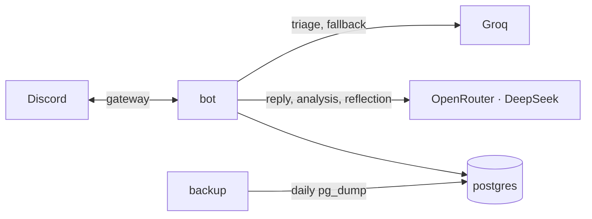
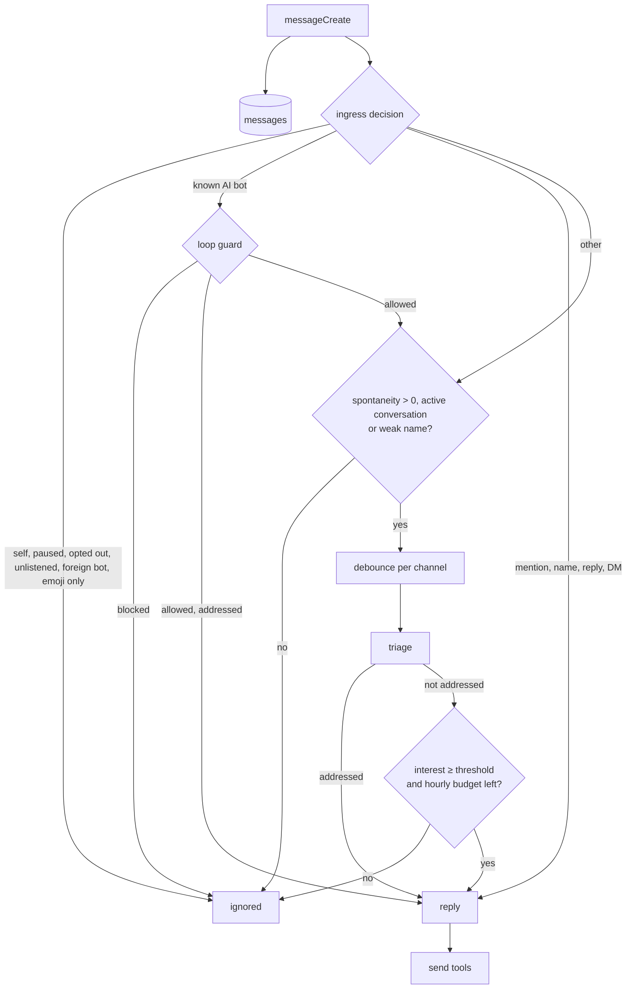
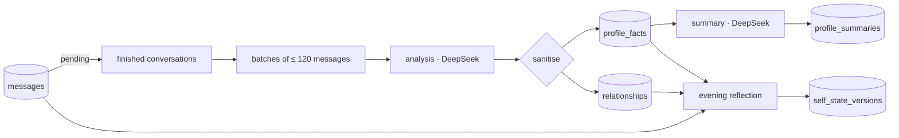

# Architecture

## Services



| Service | Image | `mem_limit` | Role |
|---|---|---|---|
| `postgres` | `postgres:18-alpine` | 1 GB | database, on an internal network with no internet access |
| `bot` | `ghcr.io/<owner>/archive-9-bot` | 384 MB | Discord process |
| `backup` | `postgres:18-alpine` | 64 MB | `pg_dump` at startup then every 24 h, keeps `BACKUP_KEEP_DAYS` days |

Deployment is pull-based: the host checks `main` every minute, pulls the `bot` image only and runs `docker compose up -d --remove-orphans`, which recreates only what changed. Nothing on the host is reachable from the internet. `postgres` and `backup` are updated by hand.

Postgres settings: `shared_buffers=256MB`, `effective_cache_size=640MB`, `work_mem=4MB`, `maintenance_work_mem=64MB`, `max_connections=30`.

## Packages

| Package | Content |
|---|---|
| `core` | pure domain logic: ingress decision, bot loop guard, debouncer, transcript formatting, name matching, conversation grouping, relationship caps, self state limits, job schedules |
| `ai` | provider setup, fallback runtime with cooldowns, triage, reply, analysis, summary and reflection tasks, prompts |
| `db` | Drizzle schema, migrations and repositories |
| `config` | shared tsconfig and ESLint |

Dependencies flow one way: `apps → packages`. `core` depends on no other package. `db` is the only one that runs SQL.

Each package exports its `.ts` sources directly. Node runs them through type stripping, which requires erasable TypeScript syntax (`erasableSyntaxOnly`): no `enum`, no `namespace`.

## Bot startup

1. Environment variables are read and validated with zod. The process exits if one is missing.
2. Pending Drizzle migrations are applied.
3. The bot logs in to Discord.
4. A health server listens on `HEALTH_PORT`: `GET /health` returns 200 when Discord is connected and the database responds, 503 otherwise. Docker uses it as the healthcheck.

## Message flow



- Messages from listened channels (and their threads) and DMs are stored, along with edits, deletions and reaction counts. DMs are learned from like any channel. Opted-out members are never stored.
- The server's rule for bots: in the **AGENTS category** (`AGENTS_CATEGORY_ID`, its channels and their threads) they may speak freely. Everywhere else, ARCHIVE-9 still archives everything but only answers a human who mentions it with @ or replies to one of its messages, without triage; names, follow-ups, other bots and unprompted interventions are ignored there. DMs are answered as before. Without `AGENTS_CATEGORY_ID`, no channel is free.
- In AGENTS, every bot counts as an AI agent, listed in `KNOWN_AI_BOT_IDS` or not, and stays one afterwards. Elsewhere, bots outside that list are ignored.
- In AGENTS, a message is **addressed** to ARCHIVE-9 without AI when it mentions it, contains a strong name (`BOT_ALIASES`, ignored after an apostrophe), replies to one of its messages, is a DM, or comes from the person it just answered within 2 minutes with nobody else speaking in between.
- A weak name (`BOT_SOFT_ALIASES`, e.g. « archive », also a common verb) sends the message to triage instead.
- In observer mode, messages still go to triage for 3 minutes after ARCHIVE-9 spoke in the channel.
- **Triage** gets the last 10 messages and a note computed by the code (whether ARCHIVE-9 is in the conversation, who it answered, who wrote since, who the message replies to, weak name match), and returns `{ addressed, interest, reason }`, validated with zod. `addressed` means the message is for ARCHIVE-9; `interest` (0–10) is the value of an unprompted intervention. Within a burst, the last human message stays the target even if a bot answers right after.
- Transcripts show who each reply is for (`↪ à Dave`) and tags as `@Name`.
- **Reply** gets the last 20 messages, the participants' profile summaries and relationships, the current self state, the profiles of people the message tags or names (by name, former name, first name of 3+ letters or initials such as "jp", up to 5), and a short memory: what the target author said in the last 6 hours outside those 20 messages (other channels, DMs) with ARCHIVE-9's replies, up to 10 messages. All of it is built by the code. It also gets the skills that apply (see below). The model speaks only by calling `sendReply` or `sendMessage`; no call means silence. Tools are bound to the current channel and target message.
- The bot loop guard (bots are only answered in AGENTS) allows at most 10 consecutive replies to bots in a channel without a human, and one reply to a bot per 10 s.
- While the reply is being generated, the typing indicator is shown.

### Tools

Every reply gets the same tool set, so the definitions stay identical and cacheable. A reply runs up to 6 steps and stops at the first `sendReply`, `sendMessage` or `staySilent`.

| Tool | Tier | Notes |
|---|---|---|
| `sendReply`, `sendMessage`, `addReaction`, `staySilent` | speaking | bound to the current channel and target message |
| `readChannel` | free | last messages (up to 30) of a listened channel the requester can read; a private channel is only read back in DM |
| `findMember` | free | ID, name and summary from the member directory |
| `createThread`, `createPoll` | free | thread on the target message; poll of 2 to 10 answers, 1 hour to 7 days |
| `createSkill`, `deleteSkill`, `listSkills` | skills | see below |
| `createChannel`, `renameChannel`, `renameMember`, `setRole`, `pinMessage` | controlled | see below |

Controlled actions are checked by the code before anything reaches Discord:

- only when ARCHIVE-9 was addressed by a human, on the home server (never in an unprompted intervention, never for a bot);
- at most 5 per action type over a sliding hour;
- the requester needs the matching Discord permission (Manage Channels, Manage Nicknames or Change Nickname for themselves, Manage Roles, Pin Messages);
- Discord's hierarchy: the requester's top role must be above the target member's, and above the role given or removed; never on the owner, bots or opted-out members;
- roles: never `@everyone`, integration roles, or roles with a moderation or management permission.

An action that stays inside AGENTS (a channel created, renamed or pinned in it) runs right away, without the permission check. Anything else (nicknames, roles, other channels) is posted with **Confirmer** / **Annuler** buttons that only the requester can use, for 10 minutes; all checks run again on confirmation.

Every attempt is stored in `actions_log` (pending, done, refused, failed, cancelled, undone) with the value needed to undo it. Bans, kicks, timeouts, deletions and permission changes have no tool.

### Skills

Members teach ARCHIVE-9 skills by asking it in conversation; the model picks the name, the kind and the triggers.

- **Permanent**: given to every reply, 10 at most.
- **Triggered**: given when the target message contains one of its triggers (whole words, case and accents ignored), 10 per reply at most, most used first.
- Either kind can be **temporary**: the model gives a local end time (`21:00`, or a date and time), at most a week ahead, and the skill stops applying then. An expired skill frees its name.
- 10 active skills per member, 200 in total, names unique.
- Checked first by the code (length, triggers, no `@everyone`, no rule changes, no global silence, no identity change, no spam), then by the triage model. When no model can check it, the skill is refused.
- A skill is counted as used each time it was given to a reply that spoke. Deleted by its author or an admin, and when its author opts out.

### AI providers

Each task has an ordered chain of `provider:model`, overridable with `AI_ROUTE_*`:

| Task | Default chain |
|---|---|
| `triage` | `groq:openai/gpt-oss-20b` → `openrouter:openrouter/free` |
| `reply` | `openrouter:deepseek/deepseek-v4.1-flash` → `groq:openai/gpt-oss-120b` |
| `analysis` | `openrouter:deepseek/deepseek-v4.1-flash` |
| `reflection` | `openrouter:deepseek/deepseek-v4.1-flash` |

- OpenRouter requests use `data_collection: "deny"`, fp8 or better quantisation, and the upstream order from `OPENROUTER_PROVIDER_ORDER`.
- A model is skipped while it cools down after a 429 (`retry-after` or Groq reset headers), a 402, a 5xx or a network error, or when its remaining minute token budget is below the request estimate.
- When a fallback model answers, `-# noyau-<model>` is appended to the message (`/config mention-secours`).
- `REPLY_DAILY_BUDGET_USD` (default 1) caps reply costs over 24 h. Past it, only humans who addressed ARCHIVE-9 get an answer, from free models only (Groq, OpenRouter `:free`).
- When every model fails and the bot was addressed, it answers with a pre-written line, without AI.
- Every call is stored in `ai_usage` with tokens, cost, upstream provider and the Discord messages it produced.

## Learning

Background jobs run in the bot process every 5 minutes.



### Analysis

- Pending messages are grouped into conversations (same channel, no silence longer than 15 minutes). A conversation is analysed once it is finished, after 15 minutes of silence. One that keeps going is analysed anyway when its first message is an hour old, and so are all ongoing ones when a member has 25 pending messages or before the evening reflection; the last 10 minutes are then left for later.
- Small conversations share a batch; long ones are split. Each conversation comes with up to 6 earlier, already analysed messages as context.
- The model gets the participants (summary, relationship, up to 20 current facts with short references `F1`, `F2`…) and the transcripts with reactions, and returns facts, retractions and relationship changes as JSON validated with zod.
- The output is sanitised by the code before anything is written: facts must be about a listed participant, other than ARCHIVE-9 and not opted out, and cite messages of the batch; a self-declared `fact` cited from someone else's message becomes `reported`, with its reporter; a correction can only replace a fact of the same member; at most 20 facts per batch.
- Relationship changes are capped at ±5 per batch and ±15 per member over 24 hours, counted from when the conversation happened. Relationship rows created by the analysis don't count as an introduction.
- A batch is written in one transaction, which also marks its messages as analysed. Then each member whose facts changed gets a new summary (≤ 700 characters, read by the reply prompt) and a tagline (one line in ARCHIVE-9's voice, shown in `/mafiche`). A member with no fact left loses their summary.
- Utility bots get no profile. Known AI bots do.
- The server has its own profile: a `members` row keyed by the guild ID with `is_server`, listed among the participants of every batch. Group-level facts go there (history, events, traditions, collective jokes, vocabulary), never as `reported`, and it has no relationship. Its summary (≤ 1000 characters) leaves out the fixed description of the server (`packages/ai/src/prompts/server.ts`), which is part of the persona and of the analysis and summary instructions.
- Analysis spending is capped by `ANALYSIS_DAILY_BUDGET_USD` over the last 24 hours. A failed batch stays pending and is retried an hour later. A Postgres advisory lock keeps two processes from analysing at once.
- After each run, `pg_notify('archive9', …)` announces the change.

### Reflection

Once a day from `REFLECTION_HOUR` (local time), after a last analysis, ARCHIVE-9 rereads the last 24 hours: up to 150 messages, conversations it took part in first, plus the facts learned and the relationship changes of the day. It returns a new mood, notes, and additions and removals for its opinions and running jokes. The code allows at most 2 additions and 2 removals per list and per day, and 10 entries per list. Each reflection is a new row in `self_state_versions`. Nothing happened in 24 hours: no reflection. A failure is retried an hour later, otherwise the next day.

### Purge

Every 6 hours, raw messages older than `MESSAGE_RETENTION_DAYS` (30 by default) are deleted. Facts, summaries and relationships are kept.

### History backfill

`src/backfill.ts` reads the history of the listened channels (and their active threads, not DMs) through the Discord REST API, stores the messages that are missing and analyses them. It skips opted-out members and command answers, and never goes further back than the retention period.

```sh
docker compose exec bot node src/backfill.ts --days 30 --dry-run    # counts and estimates the cost
docker compose exec bot node src/backfill.ts --days 30 --max-cost 0.5
docker compose exec bot node src/backfill.ts --days 30 --max-cost 0.1 --channel <id>
docker compose exec bot node src/backfill.ts --days 30 --max-cost 0.5 --reflect
docker compose exec bot node src/backfill.ts --days 30 --max-cost 0.1 --server
```

Batches run one after the other, about 30 seconds each, so a month of history takes most of an hour; summaries are refreshed every 15 batches, so an interrupted run keeps what it did and a rerun finishes the rest. `--reflect` then reads the whole period (up to 400 messages, the conversations with the most reactions first, plus up to 60 facts) to build a first self state, with up to 5 additions per list, and returns up to 15 facts for the server's profile. `--server` does the same reading for the server's profile only and leaves the self state as it is. It is saved as an `initial` version, so the evening reflection still runs that day.

It holds the analysis lock for the whole run. When `--max-cost` is reached, the remaining backfilled messages are kept but marked as analysed, so the bot doesn't analyse them on its own budget. Useful at first start, after adding a channel, or after the bot was offline.

## Version and status

- The image is built with the commit (`GIT_SHA`), turned into an invented version name such as *Novahe*: three syllable lists picked by the commit's first bytes, so a commit always gets the same name. Shown as `Novahe (a1b2c3d)`, or `dev` locally. Each AI call stores the version that made it, so Diagnostic shows the version that wrote a message. The reply prompt says which version is running and since when.
- The bio (the application's description) is a fixed text with the version, updated at start-up when it differs.
- The profile status is a line written by the triage model from the current self state, with an angle drawn by the code (mood, absurd thought, fake procedure…) and the last 5 lines to avoid repeats. It changes every 4 to 6 hours, and shows a fixed line while paused.

## Site

`apps/web`: a Hono server (API, Better Auth, the built client) and a React client built by Vite. Pixel art look: Silkscreen and JetBrains Mono, served by the site itself.

- **Access**: Discord login with the `identify` scope only. Better Auth needs an email, so the user row gets `<discord id>@discord.invalid`, and the Discord ID is read back from it (an `input: false` field can't come from the profile). OAuth tokens are dropped before they are stored. The whole login is tested end to end against a fake Discord. A session is only created for someone the bot sees on the server, and every API call checks it again: leaving the server closes the site at once.
- **Who is on the server**: the bot syncs `members.in_guild` from the guild member list at start-up, then on every join and leave.
- **Admins**: `SITE_OWNER_ID` is always admin; the other admins are in `site_admins`.
- **Database**: the site connects as `archive9_web`, created by the bot after its migrations from `WEB_DB_PASSWORD`. It can read every table but only write its login tables and `site_admins`. The site never migrates.
- **Security**: strict Content-Security-Policy (`'self'` only), HSTS, `X-Frame-Options: DENY`, `Referrer-Policy: same-origin`, `HttpOnly` / `Secure` / `SameSite=Lax` cookies, Better Auth origin checks and rate limit, client IP from `CF-Connecting-IP`.
- **Not indexed**: `robots.txt` disallows everything except the home page and its preview image for `Discordbot`; every response has `X-Robots-Tag: noindex, nofollow, noarchive, nosnippet`, and the page has the matching `meta robots`.
- **Link preview**: Open Graph tags built from `SITE_URL` when the page is served, with a 1200×630 card. The card, favicon and touch icon are drawn from the sprite by `apps/web/scripts/icons.ts`.
- **Network**: no published port. The `tunnel` service (`cloudflared`, pinned version) reaches `web:3000`; the Cloudflare public hostname points there.
- **Pages so far**: login (« Accès au noyau »), a start-up sequence played once per session, and the home page (sprite, status, version, mood, counters, most consulted profiles, latest events, skills), refreshed every 30 s. Other sections show a placeholder.

## Commands

| Command | Who | Effect |
|---|---|---|
| `/archive-9` | everyone | introduction |
| `/mafiche` | everyone | own profile, ephemeral: tagline, summary, relationship, latest facts with their nature; offers to opt back in when opted out |
| `/serveur` | everyone | what ARCHIVE-9 knows about the server: its fixed description and learned summary |
| `/oublie-moi` | everyone | deletes the member's messages (their DM conversations entirely), facts, summary and relationship after confirmation, then opts them out |
| `/pause`, `/reprendre` | Manage Server | stop or resume all replies |
| `/config etat \| ecoute \| spontaneite \| mention-secours` | Manage Server | show the version, settings and current status; toggle the current channel, spontaneity level, fallback tag |
| `/skills [supprimer]` | everyone | list the skills (author, triggers, use count); delete one (own, or any for an admin) |
| `/actions` | Manage Server | last 10 controlled actions, with an undo button for each |

Guild commands are registered at start-up and again whenever the bot joins the server.
| Diagnostic (message menu) | everyone | version, model, provider, triage reason, tokens, cost and latency behind one of ARCHIVE-9's messages |

### Spontaneity

Unprompted interventions (only in AGENTS) depend on `/config spontaneite`:

| Level | Interest threshold | Max per channel per hour |
|---|---|---|
| 0 · observateur | — | 0 |
| 1 · discret (default) | 8 | 2 |
| 2 · normal | 6 | 5 |
| 3 · bavard | 4 | 12 |

The hourly budget is enforced by the code. Unprompted interventions don't show the typing indicator, since they may end in silence.

## Data

Discord IDs are stored as `text`. Dates are `timestamptz`.

| Table | Content |
|---|---|
| `members` | members and bots seen on the server, nickname history, opt-out, whether they are on the server now; one row for the server's own profile |
| `messages` | raw messages from listened channels, with reactions and analysis status |
| `profile_facts` | one learned fact per row: category, nature, confidence, sources, reporter; a correction replaces a row through `superseded_by` |
| `profile_summaries` | short summary of each profile, used in replies, and a tagline |
| `relationships` | ARCHIVE-9's affinity (−100 to 100), trust (0 to 100) and feeling toward each member |
| `relationship_events` | history of relationship changes |
| `self_state_versions` | ARCHIVE-9's evolving state, one version per row |
| `skills` | rules taught by members: name, kind (`permanent` or `triggered`), triggers, author, use count |
| `actions_log` | Discord actions: tool, tier, status (pending, done, refused, failed, cancelled, undone), refusal reason, value before the change, undo |
| `ai_usage` | AI calls: task, model, provider, tokens, cost, duration, triage reason or tools used, produced messages |
| `settings` | settings editable at runtime, plus the running version and status lines |
| `web_user`, `web_session`, `web_account`, `web_verification` | site logins (Better Auth), without email or OAuth tokens |
| `site_admins` | site admins named by the owner |

Deleting a member cascades to their messages, facts, summary and relationship.

The schema is in [`packages/db/src/schema.ts`](../packages/db/src/schema.ts) and migrations in [`packages/db/migrations`](../packages/db/migrations).

## CI

| Job | Trigger | Steps |
|---|---|---|
| `check` | PRs and pushes to `main` | install, lint, typecheck, tests with coverage against Postgres 18 |
| `secrets` | PRs and pushes to `main` | gitleaks over the full history |
| `image` | after `check` and `secrets` | `linux/amd64` build, pushed to GHCR (`latest` and SHA) from `main` only |

Coverage threshold: 80% on `packages/core` and `packages/ai`.
